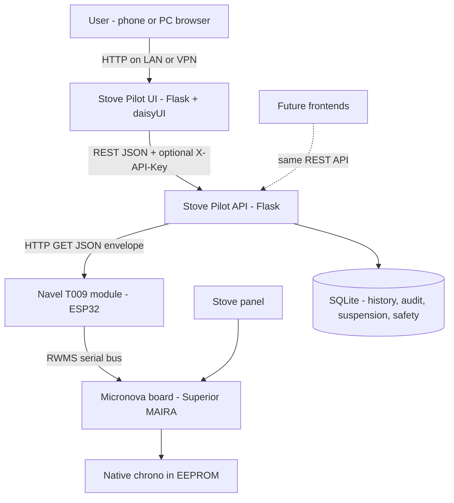
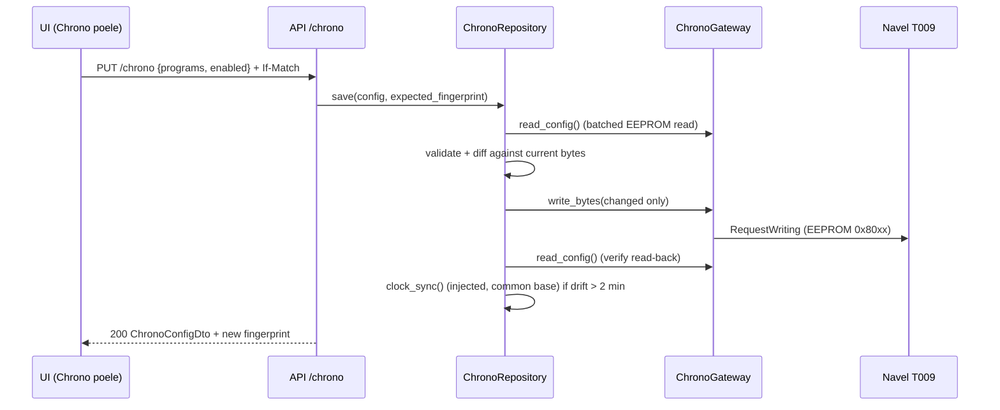
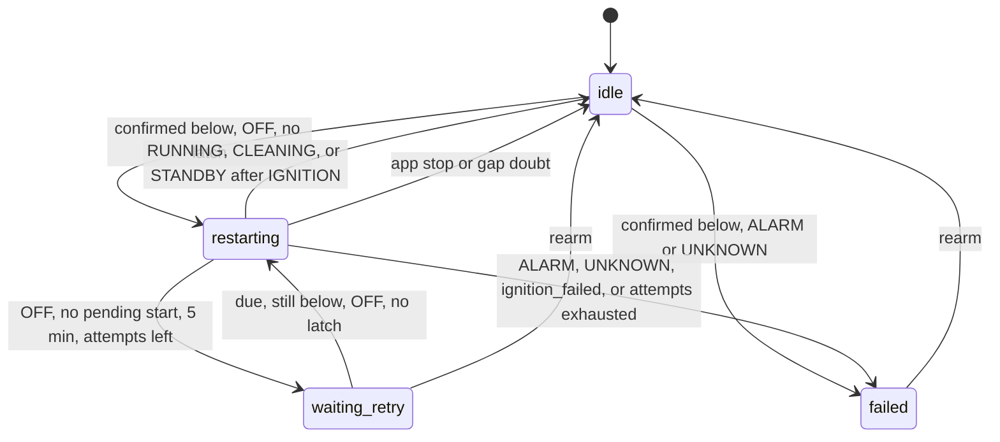

# Stove Pilot - Design Document

Local web control for a Superior MAIRA pellet stove through its Micronova Navel 2.0 (T009) Wi-Fi module, without the vendor cloud.

- Status: Proposed (rev 6)
- Date: 2026-10-22
- Companion plan: `2026-10-21-stove-pilot-implementation-plan.md`
- Rev 2 changes: automated tests removed from scope, daisyUI for the UI, two independent programming features (native stove chrono and server schedule), updated discovery findings (EEPROM encoding and write verified).
- Rev 3 changes (user-approved addendum): findings from the 2026-10-21 attended mapping session (state codes, chrono layout in 3 blocks, RAM stop verified, clock drift rate) and from the stove manual (`docs/construct/Instructions-Instructions FR_0.pdf`). New: ENERGY SAVING and DISPLAY ECO settings, maintenance counters, decoded panel messages and alarms, clock moved to the common base with auto-sync, no remote stop during ignition without confirmation, an at-a-glance summary (`/summary`, dashboard hero, embeddable `/widget`), "suspend all programming" (section 6.5), and a user-selectable display refresh (section 8.5).
- Rev 4 changes (user decision, 2026-10-22): **native chrono only**. EEPROM writes are verified, so the server schedule (Feature B) is deferred to the backlog (ADR-002 superseded, sections 6.3 and 6.4 kept for reference only). The feature registry, the suspension, and `/summary` stay feature-agnostic so it can return later.
- Rev 5 changes (user decision, 2026-10-22): the PWA is completed with a service worker and an offline page (section 8.6). Installing it on phones requires the UI behind an internal HTTPS name (section 11).
- Rev 6 changes (2026-10-23): safety restart (section 6.6). Additive `/api/v1/safety`, a Reglages card, and a dashboard glance badge. The feature never stops the stove.

---

## 1. Context

| Item | Value |
| --- | --- |
| Stove | Superior MAIRA, serial `11384562`, red LED display, 4 keys (SET, +, -, touch On/Off) |
| Controller board | Micronova (RWMS protocol, RAM + EEPROM registers). The layout matches the public `L023` family tables. |
| Wi-Fi module | Micronova Navel 2.0 / Agua IOT, type `T009_3`, firmware revision `0054`, web UI rev `1.20`. It is an ESP32 (Espressif MAC OUI). |
| Module MAC | `240AC48AA384` |
| Module secrets | Registration code and AP password are on the label. They live in `.env` only, never in the repo. |
| LAN address | `192.168.68.54` (to be pinned as a DHCP reservation) |

### 1.1 Why the official apps fail

Superior belongs to the Piazzetta group and uses the **MySuperior** app, which talks to a Piazzetta-specific Agua IOT bridge. Superior also changed cloud operator in 2025. In this flow, "MAC refused" almost always means **the module is already bound to another account** (dealer, installer, or previous owner). Support can remove the binding when given photos of the Navel label and the stove serial label. This project does not depend on that fix.

The module is an ESP32, so reflashing it with open firmware is possible, but it is not needed: the stock firmware already exposes local read/write access (section 1.2). Reflashing stays a fallback (risks: possible flash encryption, opening the module, warranty).

### 1.2 Discovery findings (verified on 2026-10-21)

**Local JSON API:**
- Endpoint: `GET http://<module>/cgi-bin/GetJson.js?<url-encoded JSON>` (`POST /cgi-bin/JsonData.js` returns 404).
- Envelope: `{"mt":"Q","s":{"sj":"<session>","ss":"browser"},"pl":{"Cmd":"...", ...}}`. Replies: `"mt":"R"` (success) or `"mt":"N"` (NACK, `pl.NackErrCode`).
- Auth: `Cmd=Identity` with `Id=<MAC>` and `Security=<AP password>`. Reply: `Devices=[{"Type":"T009_3","Revision":"0054"}]`.
- `GetBufferId` returns `BufferCnt=0`: cloud-pushed buffers are absent, so `GetBufferReading` NACKs with `-984`. That does not matter, because the direct register commands work.

**Register access (`Protocol=RWMSmaster`, `BitData=[8]`, `Endianess=["L"]`):**

| Operation | Item encoding | Status |
| --- | --- | --- |
| Read RAM | `address` (0x00 to 0xFF). Items above 0xFF NACK with `-968`. | Verified |
| Read EEPROM | `0x8000 \| address`. The `0x2000` bit is ignored, so `0x20xx` reads RAM and `0xA0xx` equals `0x80xx`. | Verified |
| Write EEPROM | `RequestWriting`, same item as the read, `Values=[v]`, `Masks=[255]`, `mt="Q"` | **Verified**: EEPROM `0x7D` 16 to 17, read back 17, stable |
| Write RAM | `RequestWriting` with item `address` | **Verified** for the stop recipe (`0x21 = 6`, 2026-10-21) |

The module sometimes returns an empty body. Reads retry up to 4 times. A write is never retried blindly: the caller reads the byte back first.

**Register map (live values):**

| Register | Value | Meaning | Status |
| --- | --- | --- | --- |
| RAM `0x01` | 33 to 41 | Ambient temperature x2 | Verified (tracked the panel through a heating cycle) |
| RAM `0x21` | see state table | Stove state code | Verified (observed cycle) |
| RAM `0x3E` | 24 to 90 | Fumes temperature (C) | Verified (observed cycle) |
| RAM `0x7A` to `0x80` | s, weekday, h, min, day, month, year | Stove clock (binary, live) | Verified |
| RAM `0xD9` to `0xEF` | ASCII | Live text of the panel display. It scrolls, so a single read can show shuffled fragments: parse it as best effort. | Verified |
| EEPROM `0x7D` | 16 | Setpoint | **Verified, writable** |
| EEPROM `0x7F` | 1 to 3 | Power level (the panel shows `Px`) | **Verified, writable** |
| EEPROM `0x50` to `0x74` | see chrono layout | Native chrono, 3 blocks | **Verified** (panel diff plus write-back reset) |
| EEPROM `0x4C` to `0x4F` | `1 0 1 2` | Unknown, never changed during the mapping. Never written. | Unknown |
| EEPROM `0xF8` to `0xFD` | BCD | Stove clock (weekday, hh, mm, dd, MM, yy) | Verified (read). Write: Task 4 Step 6 |

**State codes (RAM `0x21`), observed on 2026-10-21:**

| Code | Panel | State |
| --- | --- | --- |
| 0 | `OFF` (with `SERVICE` alternating, and `OFF E` after a remote stop) | `OFF` |
| 1 | `CONTROLE` | `IGNITION` |
| 2 | `ALLUMAGE PHASE 1` | `IGNITION` |
| 3 | `ALLUMAGE PHASE 2` | `IGNITION` |
| 4 | `ENS` / `OK` / `Px` alternating (`OK` means the setpoint is reached and the stove modulates) | `RUNNING` |
| 6 | `NETTOYAGE BRASERO` (final cleaning after a stop) | `SHUTDOWN` |
| 7 | `ENERGY` / `OK` | `STANDBY`: the stove is on but the flame is off (ENERGY SAVING wait). It re-ignites by itself when the ambient drops below the restart threshold, and raising the setpoint above the ambient makes it re-ignite (observed 7 -> 1). |

Codes 5 and 8 and above were not observed. They decode as `UNKNOWN` until seen, so start and stop are refused in those states.

**Native chrono layout (EEPROM):** three independent blocks, each with its own enable byte. There is no master switch. Times use 10 min units, 144 = unset. The day mask uses bit 0 = Monday through bit 6 = Sunday.

| Block | Enable | Programs (2 per block) | Days |
| --- | --- | --- | --- |
| Day (`jour`) | `0x50` | P1 `0x51` start, `0x52` stop, `0x53` power, `0x54` setpoint, `0x55` unknown (always 1). P2 `0x56` to `0x5A`, same order. | every day (no mask) |
| Week (`semaine`) | `0x5B` | P1 `0x5C` start, `0x5D` stop, `0x5E` days, `0x5F` power, `0x60` setpoint, `0x61` unknown. P2 `0x62` to `0x67`, same order. | Any day (Sat and Sun can also be selected on the panel, confirmed 2026-10-22) |
| Weekend | `0x68` | P1 `0x69` to `0x6E`. P2 `0x6F` to `0x74`, same order as the week block. | Fri, Sat, Sun only |

The unknown bytes are preserved and never written.

**Clock:** the stove clock runs about **20 s per hour fast** (+903 s at 21:13, +964 s at 00:03), which is about 8 min per day. One sync on chrono save is not enough. The common base therefore auto-syncs the clock when the drift exceeds the tolerance (section 6.1).

**Panel observations:** the panel shows `SERVICE` alternating with `OFF`. According to the manual, this means the 2000 h maintenance interval is reached. `OFF E` after the remote stop means "switched off with ENERGY SAVING active": the stove will not re-ignite by itself.

Snapshots: `stove-pilot/discovery/` (`00-baseline.json` is the simulator seed, `05` to `13` are the chrono mapping, `cycle.csv` is the observed heating cycle).

### 1.3 Manual findings (operating manual, firmware FWDA00, `L023` panel family)

The manual describes a 6-key panel. The MAIRA has a 4-key panel and a different chrono structure (section 1.2 wins). The functions below are board functions, kept only when they are useful remotely.

| Function | Behavior | Use in the app |
| --- | --- | --- |
| ENERGY SAVING | At the setpoint the stove goes to P1. At setpoint + STOP offset (+1 to +3 C, or OFF) it shuts down and waits (state 7, `ENERGY OK`). At setpoint - START offset (-1 to -3 C, or OFF) it re-ignites. Exclusive with night mode and with the external thermostat STOP. A manual off (`OFF E`) disables the auto restart. The manual advises STOP = OFF (modulate at P1) when cycles are shorter than 90 min. | Show the mode and the restart threshold, edit both offsets |
| DISPLAY ECO | ON: the display turns off after 1 min without key presses, and a single dot shows that the stove is on. UNITE DISPLAY selects the time or the temperature on the main screen. | Toggle |
| MEMOIRE COMPTEUR | Total hours, partial hours, ignition count, last 5 alarms. `SERVICE` appears at 2000 h. | Maintenance card (read only) |
| Stop during ignition | It leads to `VIDER LE BRASERO ET APPUYER SUR ON/OFF`: the brazier must be emptied on site before the next ignition. | Rule change (section 6.1) |
| Chrono | Overlapping programs: the first start and the first stop win. The manual recommends at least 2 h between a stop and the next start. A power cut spanning a chrono start time cancels that ignition. | Validation and warnings |
| Messages | `NETTOYAGE BRASERO`, `VIDER BRASERO`, `SERVICE`, `FERMER` (tank lid open), `REFROIDISSEMENT`, `ENERGY OK`, `ENS`, `OFF E` / `OFF N` / `OFF T`, `REDEMARRAGE MANQUE DE TENSION`, `NO CHARGE`, `CLAVIER BLOQUE` | Decoded alerts with a French action |
| Alarms | E1 pressure switch, E2 pressure switch at ignition, E3 pellet tank overheat, E4 fumes overheat, E6 auger, E7 fumes too cold (empty tank or dirty brazier), E8 fumes probe, E9 and E14 ignition threshold not reached, E10 ambient probe (no shutdown), E12 fumes extractor, E13 tank lid open > 1 min, E19 external safety (N.PEL) | French title, user action, "technician required" flag |

Not used (superfluous or unsafe remotely): buzzer, keyboard lock, auger loading (needs an on-site brazier check), fan V1 to V3 (two-fan models), technician data, language and units, N.PEL contact, external thermostat. Night mode (fan off, P1/P2 only) is optional and only if the MAIRA has it.

References: ESPHome Micronova (<https://esphome.io/components/micronova/>), eni23/micronova-controller (<https://github.com/eni23/micronova-controller>), HA Agua IOT integration (<https://github.com/vincentwolsink/home_assistant_micronova_agua_iot>), BLE PoC (<https://gist.github.com/kevynb/8104346c4087bb40a67d0f568e88116e>), daisyUI standalone install (<https://daisyui.com/docs/install/standalone/>).

---

## 2. Goals and non-goals

### Goals (by priority)

1. **Weekly programming** through the **Chrono poele** menu: a visual editor for the stove's built-in chrono (3 blocks of 2 programs, each with its own setpoint and power), written to the board through the module. It runs on the stove itself, so a host outage never stops the heating. A server-side schedule is deferred (rev 4, section 6.3).
2. **Live status at a glance**: ambient and fumes temperature, state, setpoint, power, stove clock, current or next programming, decoded panel message or alarm. It is shown as the dashboard hero and as a read-only embeddable widget (`/widget`, for iframes).
3. **Manual control**: start, stop, deferred restart after cooling, setpoint, power level.
4. **Energy and comfort settings**: ENERGY SAVING offsets, DISPLAY ECO (display off after 1 min), maintenance counters.
5. **Suspend all programming** in one action ("thermostat mode"): every programming feature is switched off and the stove is left (or put) in plain ENERGY SAVING operation. Resume restores exactly what was active, either manually or at an optional date.
6. **Live UI**: a user-selectable display refresh (10 s, 30 s, 1 min, 5 min, or manual with a button), so an open page stays current.
7. **Evolvable architecture**: monorepo-style layering, `service/api` (JSON backend) fully decoupled from `service/ui` (Flask + daisyUI), and each programming feature removable in minutes.

### Non-goals

- Automated test suites (unit, contract, end-to-end). Verification is manual through the CLI, `curl`, and the browser (see the plan).
- Remote alarm reset. Internet exposure (use a VPN). Multi-stove support. Agua IOT cloud integration.

---

## 3. Non-functional requirements

| NFR | Target / decision |
| --- | --- |
| Load | 1 home, 1 to 3 users. One small host. |
| Availability | The chrono runs on the stove, so heating never depends on the backend. An always-on host (NAS or Raspberry Pi) is recommended, not required: it keeps the clock auto-sync (otherwise about 8 min/day of drift), the history, and the suspension auto-resume. Running on demand from the PC works with a weekly manual clock sync. |
| Latency | A command shows up on the stove within 5 s. UI refresh: user-selectable (10 s, 30 s, 1 min, 5 min, manual; default 30 s), paused while the browser tab is hidden. A UI refresh asks for data no older than its interval: the API serves the poller cache when it is fresh enough, otherwise it does one live read, never more than one every 5 s whatever the number of open pages. The background poller stays at 30 s (history, clock sync, deferred commands). |
| Device protection | Polling every 30 s at most, one request in flight, batched reads. EEPROM writes only on user changes, diff-based (read-before-write). Clock sync writes only when drift exceeds 2 min, at most once every 6 h (about 4 one-byte writes per day). |
| Safety | No automatic ignition retry, anti-short-cycle guard, every command audited, no remote alarm reset, no remote stop during ignition without explicit confirmation (the brazier would need emptying on site). |
| Security | LAN only (the LAN is the trust boundary, no UI login), an optional API key between the UI and the API, CSRF, secrets in `.env`, redacted logs. `/widget` can be framed only by the origins listed in `STOVE_PILOT_UI_FRAME_ANCESTORS`. |
| Maintainability | Strict layering, stove and chrono layouts as TOML data, files under 500 LOC, features isolated behind registries. |
| Agent-friendliness | daisyUI semantic classes (`btn`, `card`, `stat`, `toggle`, `modal`) keep custom CSS minimal and are well known to LLM agents. |

---

## 4. Architecture

### 4.1 System context



### 4.2 Containers

| Container | Process | Responsibility |
| --- | --- | --- |
| `stove-pilot-api` | Flask + Waitress, **single process** | Owns the gateway, the status poller (history, clock sync, deferred commands, suspension checks, safety restart), persistence, `/api/v1`. |
| `stove-pilot-ui` | Flask + Waitress | Jinja2 + HTMX + daisyUI pages. Talks to the API over HTTP only. |
| `stove-pilot` (CLI) | One-shot | Discovery and maintenance: `identify`, `read`, `dump`, `diff`, `watch`, guarded `write`. |

### 4.3 Package layout

```text
zold/code/iot/
  docs/
  stove-pilot/
    pyproject.toml
    MANIFEST.in                          # ships TOML, templates, and static files in non-editable installs
    README.md
    .env.example
    discovery/                           # register snapshots (JSON) from the CLI
    tools/
      build-css.ps1  build-css.sh        # download the Tailwind standalone CLI + daisyui.mjs, build app.css
    src/stove_pilot/
      common/                            # settings, logging, exceptions (no business logic)
      lib/
        navel/client.py                  # NavelClient: Identity, RequestReading, RequestWriting
        navel/rwms.py                    # Memory enum + item encoding (RAM addr, EEPROM 0x8000|addr)
        sqlite.py
      utilities/
        weektime.py                      # COMMON BASE: Weekday, minutes <-> HH:MM, minute-of-week, BCD helpers
      core/
        stove/                           # COMMON BASE: the physical stove (used by every programming feature)
          models.py profile.py ports.py service.py simulator.py rules.py repository.py poller.py
          messages.py                    # pure: panel message parsing + alarm catalog (French texts)
          profiles/superior_maira.toml   # registers, states, commands, clock, settings, counters
        history/                         # telemetry + audit trail
          models.py service.py repository.py
        suspension/                      # COMMON BASE: "suspend all programming"; knows features only through a Protocol
          models.py ports.py service.py repository.py
        chrono/                          # FEATURE A: native stove chrono (removable)
          models.py layout.py service.py repository.py validation.py
          layouts/superior_maira.toml
        safety/                          # safety restart guard (section 6.6); not a programming feature
      service/
        app.py                           # create_api_app(), create_ui_app()
        composition.py                   # build_* factories + feature wiring
        features.py                      # FEATURE REGISTRY: name -> (api registrar, threads, summary provider, suspension participant)
        api/
          routers/  health.py stove.py settings.py history.py features.py summary.py programming.py chrono.py safety.py
          schemas/  stove.py settings.py history.py summary.py programming.py chrono.py safety.py common.py
          errors.py auth.py
        ui/
          client.py viewmodels.py nav.py # nav.py: UI menu registry
          routes/   dashboard.py widget.py settings.py history.py chrono.py safety.py
          i18n/fr.json
          templates/ base.html dashboard.html widget.html settings.html history.html chrono.html partials/ (glance.html, settings_safety.html, ...)
          static/   css/input.css css/app.css js/htmx.min.js js/refresh.js js/chrono-editor.js img/ manifest.webmanifest
        cli/commands.py
      server_api.py  server_ui.py  cli.py
```

Dependency rules:

```text
service -> core -> { lib, utilities } -> common
core/chrono     -> core/stove, core/history, utilities   (never core/suspension)
core/safety     -> core/stove, core/history, core/chrono (chrono does not import safety)
core/suspension -> core/stove, core/history              (never a feature: participants are injected through a Protocol)
core/stove, core/history -> never a feature
service/ui    -> common only (+ its own modules); it reaches the backend over HTTP
```

A manual check before each delivery: `rg "core\.chrono" src/stove_pilot/core/stove src/stove_pilot/core/history src/stove_pilot/core/suspension` must return nothing, and `rg "stove_pilot\.(core|lib)" src/stove_pilot/service/ui` must return nothing.

### 4.4 Key flows

Native chrono save:



At-a-glance summary: `GET /api/v1/summary` combines the stove status (common base) with one `ProgrammingSummary` per enabled feature and an optional `safety` block (`enabled`, `status`, `threshold_c`; section 6.6). Each feature provides its own summary through its `FeatureSpec.summary` entry, so the summary router never imports `core.chrono`. The UI renders the same partial (`partials/glance.html`) as the dashboard hero and as the standalone `/widget` page.

---

## 5. Architecture Decision Records

### ADR-001: Transport

- **Decision:** the local Navel HTTP JSON API (`Identity`, `RequestReading`, `RequestWriting`), behind a `RegisterIO` port.
- **Alternatives:** Agua IOT cloud (blocked, external dependency), BLE (needs a cloud bootstrap, short range), ESP32 serial bridge or reflashed Navel (hardware work, warranty).
- **Consequences:** zero hardware, reads and EEPROM writes verified. If a firmware update removes the API, only a new `RegisterIO` adapter is needed.

### ADR-002: Native chrono only, behind a feature registry (rev 4, supersedes "two independent programming features")

- **Status:** Accepted (rev 4, 2026-10-22).
- **Context:** rev 2 planned two features: the native chrono and a server schedule as backup. The 2026-10-21 session verified the EEPROM writes and mapped the chrono (3 blocks of 2 programs), while the RAM start that a server schedule needs is still unverified.
- **Decision:** ship only `core/chrono` as a vertical feature (its own API router, UI route and templates, menu entry, registry entry). Keep the `FeatureSpec` registry, the feature-agnostic `/summary`, and the `Suspendable` participants, so a second programming feature can be added later without touching the common base.
- **Alternatives:**
  - Both features (rev 2). More flexible (unlimited slots, presets), but it needs a 24/7 host, depends on the unverified RAM start, adds mutual-exclusion logic, and costs about 3 more days.
  - Server only. The heating stops whenever the host is down.
- **Consequences:**
  - The programming capacity is the board's: up to 4 programs per day (6 on Friday), each with its own setpoint and power. Vacations are covered by "suspend until" (section 6.5).
  - The clock drift makes an always-on host useful but not mandatory.
  - Feature B design notes stay in sections 6.3 and 6.4 and in the plan's Appendix A.

### ADR-003: UI/API split and look and feel

- **Decision:** two Flask apps. The API is pure JSON under `/api/v1`. The UI is a BFF with Jinja2 + HTMX + **daisyUI 5** (Tailwind CSS 4 standalone CLI, **no Node**). `app.css` is built once by `tools/build-css.*` and committed, so runtime has no build step and works offline on the LAN. Themes: `caramellatte` (light, warm) and `coffee` (dark), following the system preference.
- **Alternatives:** Pico CSS (lighter, but more custom CSS for a friendly look), the daisyUI CDN with the Tailwind browser script (no build, but Internet-dependent and not meant for production), an SPA (needs a JS toolchain).
- **Consequences:** a friendly, consistent look from semantic classes that LLM agents use reliably. The only extra step is rerunning `tools/build-css` after template changes that introduce new classes.

### ADR-004: Persistence

stdlib `sqlite3` in WAL mode, one file. Used by `core/history`, `core/suspension` and `core/safety` (schema `safety`). The native chrono's source of truth is the stove EEPROM, with no local copy.

### ADR-005: Concurrency

One API process owns the single `NavelClient` (lock plus a minimum gap between requests), and the poller thread (plus any feature thread declared through `FeatureSpec.start_threads`; none in the MVP). A lock file refuses a second instance.

---

## 6. Domain model

### 6.1 Stove (common base)

- `StoveState`: `OFF`, `IGNITION`, `RUNNING`, `CLEANING` (periodic brazier cleaning while on), `SHUTDOWN` (final cleaning/cooling), `STANDBY` (on, flame paused, ENERGY SAVING wait), `ALARM`, `UNKNOWN`. Code table: section 1.2.
- `StoveStatus`: `state`, `raw_state_code`, `state_label`, `ambient_temp_c`, `fumes_temp_c`, `setpoint_c`, `power_level`, `display_text`, `display_message`, `alarm_code`, `alarm`, `energy_saving`, `stove_time`, `clock_drift_s`, `polled_at`.
  - `display_message: DisplayMessage | None` (`code`, `level` info/warning/error, `title_fr`, `action_fr`), parsed best effort from the scrolling display buffer by `messages.parse_display`.
  - `alarm: AlarmInfo | None` from `messages.ALARMS` (`code`, `title_fr`, `action_fr`, `requires_technician`).
  - `energy_saving: EnergySavingStatus | None` (`enabled`, `stop_offset_c`, `start_offset_c`, `restart_below_c` = setpoint - start offset). `None` while the registers are not mapped.
  - `stove_time` (naive local, from the RAM clock read in the same batch) and `clock_drift_s` (stove time minus server local time).
- Clock (common base, not chrono): the profile `[clock]` section holds the RAM live clock and the EEPROM BCD clock. `StoveRepository.clock_status()` and `sync_clock(force=False)` write the BCD bytes only when the drift exceeds the tolerance. The poller auto-syncs (`STOVE_PILOT_CLOCK_AUTO_SYNC`, default true) at most once every 6 h, which is needed because of the 20 s/h drift. Chrono save calls an injected `clock_sync` callable.
- Settings (common base): `set_energy_saving(stop_offset_c, start_offset_c)` (1 to 3, or `None` = OFF), `set_display_eco(enabled)`, `maintenance()` (total and partial hours, ignitions, last 5 alarms, `hours_to_service` = 2000 - partial hours). Each one is available only once its registers are mapped and `verified`.
- `StoveProfile` (TOML): registers (`memory`, `address`, `scale`, `writable`, `min`, `max`, `verified`), the state code table, and command recipes. The `verified` gate applies only when `STOVE_PILOT_GATEWAY=navel`: the loader never raises on `verified = false` (so a read-only live status works on the skeleton TOML), it only records `allow_unverified`, and `StoveGateway` refuses writes to an unverified register or command recipe with `UnverifiedRegisterError` (API `409 unverified_register`). In simulator mode composition sets `allow_unverified=True`, and each such write logs one WARNING naming the register.

| Command | Allowed when | Otherwise |
| --- | --- | --- |
| `start` | `OFF`, and the last ignition was at least 15 min ago | `SHUTDOWN`, or inside the interval: **DEFER** (expires after 45 min). `IGNITION`/`RUNNING`/`CLEANING`/`STANDBY`: **NO_OP**. `ALARM`/`UNKNOWN`: **REJECT** |
| `stop` | `RUNNING`, `CLEANING`, `STANDBY` (verified: 7 -> 6 -> 0). `IGNITION` only for `source=USER` with `confirm_ignition_stop=true` | `IGNITION` from an automated source (any source other than `USER`; none issues stops in the MVP): **DEFER** until the state leaves `IGNITION` (expires after 30 min). `IGNITION` from the user without confirmation: **REJECT** `confirm_ignition_stop_required`. `OFF`/`SHUTDOWN`: **NO_OP**. `ALARM`/`UNKNOWN`: **REJECT** |
| `set_setpoint` / `set_power` | within the profile min/max | **REJECT**. An equal value is a **NO_OP** (no EEPROM write) |

### 6.2 Feature A - native chrono (`core/chrono`)

- `ChronoLayout` (TOML in `core/chrono/layouts/`, mapped on 2026-10-21, section 1.2): the time unit (10 min), the unset marker (144), and **3 blocks** (`day`, `week`, `weekend`). Each block has an enable address, `allowed_days` (empty = every day, no mask), and 2 programs with field addresses (`start`, `stop`, `days` for week/weekend only, `power`, `setpoint`). The always-1 unknown bytes are not in the layout, so they are never written. The clock is not part of the chrono layout (it lives in the stove profile, section 6.1).
- `ChronoBlockKind`: `DAY`, `WEEK`, `WEEKEND`. `ChronoProgram`: `block`, `index`, `start_min | None`, `stop_min | None` (None = unset / OFF), `days: frozenset[Weekday] | None` (None for the day block), `setpoint_c`, `power_level`. `ChronoBlock`: `kind`, `enabled`, `allowed_days`, `programs`.
- `ChronoConfig`: `blocks`, `fingerprint` (hash of the raw bytes, used for `If-Match`), and `enabled` = any block enabled.
- Validation (errors): 10 min granularity, `start != stop` when both are set (start and stop are independent daily events; `start > stop` is an overnight program that stops the next day), values within the profile ranges, days within the block's `allowed_days`, no overlap between programs of enabled blocks active on the same day (an overnight program counts as start..24:00 on its day plus 00:00..stop on the next). Warnings (non-blocking, returned with the config): less than 2 h between a stop and the next start on the same day (manual recommendation), START or STOP set to OFF, `overnight` (start after stop). With `gateway=navel`, a layout whose written fields or enable flags are not `verified` yields the issue `unverified_layout` (422), unless the layout was loaded with `allow_unverified` (simulator only); the layout loader itself never raises on `verified = false`.
- Clock: chrono save calls the injected common-base `clock_sync` (section 6.1). The chrono feature does not own the clock.
- Cache: `ChronoRepository` keeps the last decoded config for 5 min, which is enough for `/summary`, `is_enabled()`, and the suspension check without reading 37 EEPROM bytes on every UI refresh. Save, block toggle, suspend, and resume invalidate it. The cache age also bounds how late a panel-side change shows up (at most 5 min, or immediately on `max_age_s`).
- The UI is a **faithful editor of the board's capabilities**: 3 block cards (Tous les jours, Semaine, Week-end VE-DI), each with its toggle and 2 programs, plus a read-only weekly preview grid. It does not pretend to offer more slots than the board has.

### 6.3 Feature B - server schedule (`core/schedule`, deferred in rev 4)

Not part of the MVP (ADR-002). Kept as a reference for a later revival; the plan's Appendix A holds the full tasks and a revival checklist.

- `Slot(start_min, end_min, setpoint_c | None, power_level | None)`, `WeeklySchedule(enabled, days, paused_until, version)`.
- Validation: 10 min granularity, `start < end`, no overlap, minimum 30 min per slot, at most 6 slots per day, minimum 120 min gap between slots (cooling time, manual recommendation).
- Planner: the slots are flattened onto a minute-of-week timeline. Adjacent slots (including Sunday 24:00 to Monday 00:00) form one run (`ADJUST`, never stop then start).
- Runner: it acts only when the occurrence key changes (local date + slot start, so DST is safe). A manual override holds until the next boundary. A missed stop is always applied. A stop that falls during ignition is deferred until the stove leaves `IGNITION` (section 6.1). A missed start is applied only if the slot started less than 60 min ago. A failed ignition is never retried.
- With ENERGY SAVING active, a schedule stop leaves the stove in `OFF E` (no auto restart), which is what the schedule wants. A schedule start in `STANDBY` is a `NO_OP` (the stove is already armed).

### 6.4 Mutual exclusion without coupling (only if Feature B returns)

Not implemented in the MVP: with a single programming feature there is nothing to exclude. If Feature B returns, the stove must never be driven by both features at the same time. `service/composition.py` (the only place that knows both features) injects callables:

```python
# composition.py (sketch)
schedule_repo = build_schedule_repository(..., conflict_check=lambda: "native_chrono_active" if chrono_repo and chrono_repo.is_enabled() else None)
chrono_repo = build_chrono_repository(..., conflict_check=lambda: "server_schedule_active" if schedule_repo and schedule_repo.get().enabled else None)
```

- Enabling one feature while the other is active returns `409 feature_conflict` with a clear message.
- The runner skips its tick when `conflict_check()` returns a reason, for example when the chrono was enabled from the panel.
- When a feature is removed, its callable becomes `lambda: None`. Neither feature knows the other exists.

### 6.5 Suspend all programming (common base, `core/suspension`)

Goal: one button switches every programming feature off and leaves the stove in plain ENERGY SAVING operation, which means it heats on demand around the setpoint. A second button restores exactly what was active.

- `Suspendable` (Protocol, in `core/suspension/ports.py`): `name`, `is_active() -> bool`, `suspend() -> dict` (switches off and returns a JSON-safe snapshot of what was active), `resume(snapshot: dict) -> None` (re-enables only what the snapshot lists). Composition adapts each enabled feature to this Protocol, so `core/suspension` never imports a feature. A removed feature is simply absent.
  - Chrono participant: the snapshot lists the enabled blocks (`["week", "weekend"]`). `suspend` writes `0` to those enable bytes only (read-before-write). Program times and setpoints stay untouched in the EEPROM. `resume` writes `1` back to the listed blocks.
  - Schedule participant (only if Feature B returns): the snapshot is `{"enabled": true}`, `suspend` disables the schedule, and `resume` re-enables it.
- `SuspensionState`: `suspended`, `since`, `until | None`, `thermostat_mode`, `snapshots: dict[str, dict]`. It is stored in SQLite (one row), so a restart keeps the suspension and its snapshots.
- `SuspensionRepository.suspend(*, until, thermostat_mode)`:
  1. Snapshot and suspend each active participant. If one fails, the participants already suspended are resumed and the error is raised, so the system is never left half suspended.
  2. Persist the state.
  3. When `thermostat_mode` is on and the stove is `OFF`, call `stove.start(source=USER)` with all the usual guards (deferred during cooling, refused while the start recipe is unverified). The outcome is returned. The stove then regulates through ENERGY SAVING. The response warns when ENERGY SAVING STOP is OFF or unmapped, because the stove will then modulate at P1 without stopping.
  4. Record a `programming_suspended` event.
- `resume()`: resume each snapshot and clear the state (event `programming_resumed`). It never stops or starts the stove.
- Auto-resume: the poller resumes at `until` (or at the first poll after it when the API was down).
- External override: if a participant becomes active while suspended (for example a chrono block re-enabled on the panel), the suspension is cleared with the event `suspension_overridden`, so the UI never shows a false "suspended" state.
- While suspended, the chrono block toggles are locked in the UI, and the API refuses to enable a block (`409 programming_suspended`, also on a full `PUT /chrono`) (banner "Programmations suspendues - Reprendre pour modifier l'activation"). Program contents can still be edited and saved; they stay disabled until resume.

### 6.6 Safety restart (`core/safety`)

Purpose: while enabled, each successful status poll can start the stove when the room stays at or below a threshold. Non-goals: stopping the stove when the room recovers, notifications outside the dashboard and the alert history, and any change to the existing start guards.

Persisted phases (`idle`, `restarting`, `waiting_retry`, `failed`) live in the SQLite schema `safety` (`safety_config`, `safety_state`) and survive a process restart. The API status is derived and is not a phase: `disabled`, `armed`, `confirming`, `restarting`, `waiting_retry`, `failed`, `paused_manual`, `suspended_vacation`, `stale`.



Modules: `models.py`, `rules.py`, `transitions.py`, `detection.py`, `attribution.py`, `lookup.py`, `chrono_check.py`, `ports.py`, `diagnostics.py`, `repository.py`, `service.py`, `alert.py`. Enabled chrono stop minutes live in `core/chrono/stops.py`.

A start needs `STOVE_PILOT_SAFETY_CONFIRM_POLLS` consecutive plausible readings at or below `threshold_c` (band 0 to 40 C; outside it the counter is unchanged; a warmer reading resets it). The counter does not advance while the stove is lit. `SHUTDOWN` and `STANDBY` never start an attempt. `STANDBY` stays with the stove's own ENERGY SAVING logic. During `restarting`, `STANDBY` after `IGNITION` is success and returns to `idle`; a later stop is not `ignition_failed`. `STANDBY` with no `IGNITION` on the previous poll is unchanged. A stale or degraded status does nothing and does not move the phase or the counter. The unthrottled read just before a start counts the same way: when it flags the display, that poll is discarded and no start is written.

Every start is `StoveRepository.start(source=EventSource.SYSTEM)`. `decide_start` runs first on the poll that was just read, with no extra stove read. A live preview runs only when that says apply. The start call is also made when the preview says reject or no-op, only to obtain the guard's outcome, and never when it says defer. A deferred start is never created; the episode waits for the next poll and the attempt is not counted. If the start call still returns deferred (a race after the preview), it is logged and handled as before: one attempt, and the pending command is not cancelled. `applied` and an unknown write count as one attempt and enter `restarting`; an unknown write is not sent again before the retry interval. `no_op` returns to `idle`, clears the attempt counter, and does not record an attempt. A rejected start goes to `failed` with the guard reason. Any other gateway error counts no attempt and is tried on a later poll. There is no stop call. Enabled, the latch and vacation are read again immediately before the start. A save that lands during the preview drops the start and is not overwritten. A change that lands while the write is already in flight cannot cancel it. Retries run only from `OFF`, at least `retry_interval_min` apart (never below `min_restart_interval_min`; a lower stored value is clamped when read, with one warning per process), at most `max_attempts` per episode. Success is `RUNNING` or `CLEANING`, and `STANDBY` after `IGNITION`. `IGNITION` keeps `restarting`. A return from a lit state to `OFF` or `SHUTDOWN` while `restarting` fails with `ignition_failed` and is not retried. A warmer room does not rearm `ignition_failed`. `UNKNOWN` during `restarting` fails the episode, as does `ALARM` or a display alarm code. The five-minute rule for a stove that stays `OFF` is unchanged. A crash after the start write and before that attempt is saved is not recovered: one extra attempt is possible if the stove is still `OFF`, and a start that already left `OFF` is not recorded as a success.

The manual latch blocks every start until it is cleared. While enabled and not in vacation it is set by an app stop (`command=stop`, `source=USER`, result `applied`, `unknown` or `no_op`; a still-deferred result does not count) or by a panel transition from `IGNITION`, `RUNNING`, `CLEANING` or `STANDBY` to `SHUTDOWN` or `OFF`. A panel transition is not a manual stop when a non-user stop command with result `applied` or `unknown` falls in the last 5 minutes and is newer than the previous poll, or when an enabled chrono stop matches. A user stop in that window latches as an app stop. A stop older than the previous poll explains nothing. The match uses stove-local time (`polled_at` plus `clock_drift_s`): the first stopped poll lies in `[stop - 1 min, stop + STOVE_PILOT_SAFETY_CHRONO_STOP_WINDOW_MIN]`, and the previous poll is not already more than 1 minute past that stop. The polls must also be at most `min(max(3 * poll_interval_s, 90), 300)` seconds apart. Chrono disabled, unreadable, a missing clock or previous poll, or a longer gap is doubt and counts as manual. A poll-gap doubt while `restarting` latches as `paused_manual` and resets the attempts; it does not become `ignition_failed`. A stop that happens entirely inside a gap between polls, or while the process is down, with the stove `OFF` at both ends, is not observable, and the safety then starts the stove. The latch clears only on a transition from `OFF` or `SHUTDOWN` to `IGNITION` or `RUNNING`, on rearm, or when the user turns the feature on. A lit poll with no stopped previous poll keeps it.

Vacation (suspension kind `vacation`, any phase) skips evaluation and reports `suspended_vacation`. When it ends, the episode returns to `idle`, attempts reset, latch kept. A programming suspension does not suspend the safety, and saving the card is allowed during vacation. Only `enabled` going from false to true rearms and clears the latch. During `waiting_retry`, another save recomputes `next_attempt_at` from `last_attempt_at` and goes to `failed` (`attempts_exhausted`) when the attempts already reach the new maximum. That save never resets the attempts.

Rearm to `idle` also happens from `waiting_retry` or `failed` (other than `ignition_failed`) when the ambient reaches `threshold_c` plus `STOVE_PILOT_SAFETY_REARM_HYSTERESIS_C`, when the stove is seen `IGNITION` or `RUNNING`, or on `POST /api/v1/safety/rearm`. `ignition_failed` rearms only when a stopped poll is followed by `IGNITION` or `RUNNING`, on that rearm, or when `enabled` goes from false to true.

The poller runs `SafetyRepository.check` from `status_hooks` after pending commands, and `active_alert` from `alert_sources`, only after `refresh` returns. A failed refresh skips both. `active_alert` follows the same derived status as `view`: only `failed` yields the alert, so a vacation, a stale cache or a manual pause clears `SAFETY_RESTART_FAILED` on the next poll. A corrupt safety row logs one ERROR per process: `/summary` returns `safety: null`, and `GET`/`PUT /safety` and rearm answer `503 safety_unavailable`. The glance shows that failure in the shared alert line, including on `/widget`, which has no safety badge. The enabled flag and the three card numbers are seeded by `STOVE_PILOT_SAFETY_ENABLED_DEFAULT`, `STOVE_PILOT_SAFETY_THRESHOLD_DEFAULT_C`, `STOVE_PILOT_SAFETY_MAX_ATTEMPTS_DEFAULT` and `STOVE_PILOT_SAFETY_RETRY_INTERVAL_DEFAULT_MIN` until the first Reglages save. Confirm polls, the hysteresis, the poll interval and the chrono window stay process settings. `enabled` on `PUT /safety` is a strict boolean.

---

## 7. API contract (v1)

All endpoints are under `/api/v1`, take and return JSON, require `X-API-Key` only when `STOVE_PILOT_API_KEY` is set (`/health` is always exempt), and report errors as `application/problem+json`. `UnverifiedRegisterError` maps to `409 unverified_register`. `StoveStatusDto` carries `capabilities {start, stop, setpoint, power}` (true when the write is allowed), and the chrono `capabilities` carry `writable` (layout verified or `allow_unverified`). The UI shows disabled actions with the label "Non verifie - etape de reperage requise".

| Method | Path | Notes |
| --- | --- | --- |
| GET | `/health` | `{status, gateway_reachable, last_poll_at}` |
| GET | `/features` | `{"chrono": true}`. The UI builds its menus from this. |
| GET | `/summary?max_age_s=<n>` | `SummaryDto {stove, alert, energy_saving, suspension, programming[], safety}`: the at-a-glance aggregate (section 4.4). `programming` has one entry per enabled feature: `{feature, label, active, current, next, blocked_reason}`. `safety` is `{enabled, status, threshold_c}` (section 6.6), null when safety is not wired. When `status` is `failed` and the stove has no alarm, that failure is the glance alert. `max_age_s` (optional, default = poller interval): the API serves the cached status when it is younger, otherwise it does one live read (at most one every 5 s globally). |
| GET | `/stove/status?max_age_s=<n>` | `StoveStatusDto` (+ `display_text`, `display_message`, `alarm`, `energy_saving`, `stove_time`, `clock_drift_s`, `polled_at`, `stale`). Same `max_age_s` semantics. |
| GET | `/programming` | `{suspended, since, until, thermostat_mode, participants: [{name, active}]}` |
| POST | `/programming/suspend` `{until?: datetime, thermostat_mode: bool = true}` | `{state, start_outcome \| null, warnings[]}`. `409 already_suspended` |
| POST | `/programming/resume` | `{state}`. `409 not_suspended` |
| POST | `/stove/commands/start`, `/stove/commands/stop` | `CommandOutcomeDto {result: applied\|no_op\|deferred, reason, status}`. The stop body may carry `{"confirm_ignition_stop": true}`. `409 command_rejected` (including `confirm_ignition_stop_required`), `429` rate limit |
| PUT | `/stove/setpoint` `{value_c}`, `/stove/power` `{level}` | `422` when out of range |
| GET | `/stove/clock` | `{stove_time, server_time, drift_s, auto_sync, last_sync_at}` |
| POST | `/stove/clock/sync` | `{stove_time, drift_s}` (forced sync) |
| GET | `/stove/settings` | `{energy_saving: {enabled, stop_offset_c, start_offset_c, writable} \| null, display_eco: {enabled, writable} \| null}` |
| PUT | `/stove/settings/energy-saving` `{stop_offset_c, start_offset_c}` | `null` = OFF. `422` out of 1..3, `409 unverified_register` |
| PUT | `/stove/settings/display-eco` `{enabled}` | `409 unverified_register` |
| GET | `/stove/maintenance` | `{total_hours, partial_hours, ignitions, hours_to_service, last_alarms[]}`, read on demand. `404` until the counters are mapped |
| GET | `/history/temperatures?from&to&bucket_min`, `/events?limit` | |
| **Feature A** | | |
| GET | `/chrono` | `ChronoConfigDto {enabled, blocks[{kind, enabled, allowed_days, programs[]}], warnings[], capabilities{setpoint_range, power_range, writable}}` + `ETag: <fingerprint>` |
| PUT | `/chrono` | Full config + `If-Match`. `412` when changed on the panel meanwhile, `422` issues, `409 programming_suspended` when it would enable a block while suspended |
| PUT | `/chrono/blocks/<kind>/state` `{enabled}` | `409 programming_suspended` when enabling while suspended |
| GET | `/chrono/fingerprint` | `{fingerprint}` (cheap change detection for the open editor, served from the 5 min cache unless `max_age_s` is given) |
| **Safety** | | |
| GET | `/safety` | `SafetyDto`: card, bounds, derived status, attempts, `last_attempt_at`, `next_attempt_at`, `failure_reason`, `paused_reason`, `last_check_at`, `warning` |
| PUT | `/safety` | `{enabled, threshold_c, max_attempts, retry_interval_min}`, all required whole numbers (`10.0` accepted, `10.5` rejected). `422` outside the range. Not refused during vacation. Event `setting_changed` (`setting=safety`). Enabling (false to true) rearms; other saves do not |
| POST | `/safety/rearm` | `SafetyDto`. Event `safety_rearmed` (`source=USER`) |

---

## 8. UI design (daisyUI)

Principles: mobile-first, large touch targets, French UI copy (`i18n/fr.json`), warm themes (`caramellatte` / `coffee`), installable PWA, no CDN.

Navigation: a `navbar` on desktop and a `dock` (bottom bar) on mobile. Entries come from `ui/nav.py` filtered by `GET /api/v1/features`: **Tableau de bord**, **Chrono poele**, **Historique**, **Reglages**.

### 8.1 Dashboard

```text
+----------------------------------------+
| [navbar] Poele salon                   |
| +------------------------------------+ |
| | GLANCE (partials/glance.html)      | |  hero card, also used by /widget
| | 17.0 C        cible 19 C           | |  large ambient + setpoint
| | fumees 82 C   P2   [En marche]     | |  badge color by state
| | horloge poele 23:48 (+16 min !)    | |  warning badge if drift > 2 min
| | Chrono poele : en cours 06:30-08:00| |  one line per enabled feature
| | alert: Veille economie - rallumage | |  decoded message / alarm
| |        automatique sous 14 C       | |
| +------------------------------------+ |
| | Consigne  [-] 19 C [+]             | |  join buttons
| | Puissance [-]  2   [+]             | |
| +------------------------------------+ |
| [   btn btn-primary btn-lg ALLUMER   ] |  confirm modal for stop
| [ btn-outline Suspendre les programmations ]  or "Reprendre" when suspended
| sparkline 24 h (inline SVG)            |
| timeline: derniers evenements          |
| [dock] Accueil | Chrono | Hist | Regl   |
+----------------------------------------+
```

- The glance card refreshes at the user-selected interval (section 8.5) from `GET /summary`.
- Suspension: when suspended, the glance shows an `alert-info` "Programmations suspendues depuis 14:02 (jusqu'au 28/10) - mode thermostat" and the programming lines are greyed out. The "Suspendre les programmations" button opens a `modal` with:
  - an optional "Jusqu'au" date and time;
  - a checkbox "Passer en mode thermostat (allumer le poele s'il est eteint)", checked by default when the stove is `OFF`;
  - the API warnings (for example "Economie d'energie sans arret : le poele modulera en P1 sans s'eteindre").
  "Reprendre les programmations" restores the snapshot without starting or stopping the stove. The button is hidden when no programming feature is enabled.
- Alerts come from `display_message` and `alarm`, with the French action: `VIDER BRASERO`, `FERMER` and alarms use `alert-error` (alarm text: "Reinitialisez l'alarme sur le poele" plus the manual's action), `SERVICE` uses `alert-warning` ("Entretien annuel a prevoir"), the ENERGY SAVING wait uses `alert-info` ("Veille economie - rallumage automatique sous X C"), deferred restart uses `alert-info`, and a stale status uses `alert-warning`. When the derived status is `failed` and the stove is not in alarm, that failure is the glance alert, ahead of the other non-alarm alerts ("Rallumage de securite impossible", code `SAFETY_RESTART_FAILED` in the alert history).
- Safety badge: while the feature is enabled, the non-compact glance header shows a shield and the threshold (`macros/safety_badge.html`, next to the state badge). Armed and confirming are neutral, restarting and waiting are info, failed is error, and paused, vacation or stale is muted. `/widget` does not set `show_safety`, so it has no badge.
- Stop confirmation modal: during ignition it adds "Arreter pendant l'allumage imposera de vider le brasero sur place avant de rallumer" and sends `confirm_ignition_stop=true`.

### 8.1b Embeddable widget (`/widget`)

- Renders only the glance card: no nav, no controls (read only), HTMX polling every `refresh` seconds (default 30).
- Query parameters: `theme=light|dark|auto`, `compact=1` (one-line layout for small iframes), `refresh=<s>` (10, 30, 60, or 300; `0` is not allowed because an iframe has no refresh button). The iframe follows the same hidden-tab pause as the main UI.
- Headers: `Content-Security-Policy: frame-ancestors <STOVE_PILOT_UI_FRAME_ANCESTORS>` (default `'self'`, for example `'self' http://homeassistant.local:8123`). No `X-Frame-Options: DENY` on this route. It is CSRF-exempt because it is read only.

### 8.1c Reglages

One `card` per block, each disabled with the "Non verifie - etape de reperage requise" label until its registers are verified:
- "Economie d'energie": a toggle plus two selects (+1/+2/+3/OFF, -1/-2/-3/OFF), with the explanation "S'eteint a consigne +X, se rallume a consigne -Y". It reminds the user that the manual advises OFF for cycles under 90 min.
- "Afficheur": a DISPLAY ECO toggle ("Eteindre l'afficheur apres 1 min sans appui").
- "Horloge du poele": time, drift, auto-sync status, and a "Synchroniser" button.
- "Entretien": total and partial hours, ignitions, hours to the 2000 h service, and the last 5 alarms with French titles.
- "Affichage": the refresh selector (section 8.5), the same control as the navbar one, for mobile users.
- "Securite" (`partials/settings_safety.html`, view `service/ui/safety_view.py`, posts in `service/ui/routes/safety.py`): enable toggle, threshold in C, maximum attempts, and minutes between attempts (`step="1"`, bounds from the DTO). Save does not rearm. "Rearmer" is shown only for `paused_manual`, `failed` and `waiting_retry`. The card shows the last check and, when `threshold_c` is not strictly below the setpoint, the warning `threshold_not_below_setpoint` (informative, not blocking). Vacation mode does not lock the card. The hint says to disable the safety before maintenance.

### 8.2 Chrono poele (native)

- Header: the stove clock `stat` with drift ("Horloge du poele : 20:03, +15 min") and a "Synchroniser" button (common clock endpoint).
- Three block `card`s: "Tous les jours", "Semaine", "Week-end (VE-DI)". Each one has an enable `toggle` and 2 programs with start/stop `<input type="time" step="600">` plus a "Pas d'allumage" / "Pas d'arret" option (OFF), day chips limited to the block's `allowed_days` (week and weekend only), and setpoint and power `select`s.
- Warnings (non-blocking): a gap under 2 h, and "the first start and the first stop win when programs overlap".
- A read-only weekly preview grid below the cards, so the user sees what the stove will do.
- Save sends `If-Match`. A `412` shows a modal "Le chrono a ete modifie sur le poele, recharger".
- Live updates (section 8.5): on each refresh tick the page only polls `GET /chrono/fingerprint`. If the fingerprint changed and the form has no local edit, the cards reload silently. If the user is editing, a sticky `alert-warning` "Le chrono a ete modifie sur le poele - Recharger" appears and the local edits are never overwritten.
- While programming is suspended, the block toggles are locked with the suspension banner.

### 8.3 Programmation serveur (deferred in rev 4)

Not in the MVP (ADR-002). The deferred page design (weekly grid, day editor, presets, pause) is in the plan's Appendix A.

### 8.4 Historique

24 h / 7 d / 30 d temperature charts (inline SVG) and an event `timeline` with filters.

### 8.5 Display refresh (all pages)

- Selector: a `dropdown` in the navbar (clock icon plus the current value) and a copy in Reglages > Affichage. Choices: **10 s**, **30 s** (default, `STOVE_PILOT_UI_REFRESH_DEFAULT_S`), **1 min**, **5 min**, **Manuel**. The choice is stored per device in `localStorage` (`stovePilot.refreshS`), so a wall tablet and a phone can differ.
- Mechanism (`static/js/refresh.js`, about 80 LOC, no framework):
  - one timer per page dispatches a `refresh-tick` event on `document.body` every N seconds;
  - each live region declares `hx-trigger="refresh-tick from:body"` and appends `max_age_s=N` to its request, so the API reads the stove only when its cache is older than the display interval;
  - the timer pauses while `document.visibilityState` is `hidden` and fires one immediate tick when the tab becomes visible again;
  - after a command, the API response carries `HX-Trigger: refresh-now`, which triggers an immediate tick (with `max_age_s=0`), plus a follow-up tick 5 s later because the stove reacts within 5 s.
- Manual mode: no timer. A "Actualiser" button (`btn btn-ghost btn-sm`, refresh icon) in the navbar fires a tick with `max_age_s=0`. The button is visible in every mode.
- Freshness indicator: "Mis a jour il y a 12 s" under the glance card, computed client-side from `polled_at`. It turns `text-warning` when older than twice the interval, or when `stale` is true.
- What refreshes on a tick:

| Page | Regions refreshed | Notes |
| --- | --- | --- |
| Dashboard | glance, controls (buttons depend on the state), events timeline | sparkline every `max(N, 5 min)` |
| Chrono poele | fingerprint check only | never overwrites local edits |
| Historique | chart and timeline | every `max(N, 1 min)` |
| Reglages | clock card | forms are never refreshed while focused |
| `/widget` | glance | own `refresh` query parameter |

### 8.6 PWA and offline

The manifest (`/manifest.webmanifest`) is completed by a service worker (`/sw.js`, scope `/`) and an offline page (`/offline`). The UI pilots a live device, so a cached page must never pass for the current stove state:

| Request | Strategy |
| --- | --- |
| Non-GET (commands, forms, CSRF) | never intercepted |
| HTMX fragments (`HX-Request` header) | network only (the stale banner logic is unchanged) |
| `/widget` | never intercepted (the embed keeps its own framing headers) |
| Shell assets (CSS, JS, icons, manifest, offline page) | cache first |
| Page navigations | network first; on failure, the offline page, never a cached dashboard |

- The cache name carries a hash of the precached files and PWA templates, computed at UI startup, so every asset deploy replaces the cache automatically.
- The offline page is standalone: no API call, no navigation context, system light/dark theme.
- Browsers register service workers only in a secure context (HTTPS or `localhost`). On plain `http://<lan-ip>:8711` the registration is skipped and the UI behaves as before; installing on phones needs the internal HTTPS name of section 11.

---

## 9. Risks and mitigations

| Risk | Mitigation |
| --- | --- |
| RAM writes (start/stop) not accepted | Stop verified (`0x21 = 6`). Start still to test (Phase 0). Alternatives: the IR key emulation register (RAM `0x58`), or raising the setpoint above the ambient while in `STANDBY` (observed to re-ignite). Last resort: ESP32 bridge or reflashed Navel. |
| Remote stop during ignition | It forces an on-site brazier emptying. A user stop needs explicit confirmation, and any automated stop is deferred. |
| Scrolling display text misread | `parse_display` is best effort (keyword match on the concatenated buffer). Alerts never drive commands. |
| Chrono layout misread | Panel-change + dump + diff mapping. The layout is marked `verified` per field. With the real module (`gateway=navel`), the editor refuses to save until the layout is verified (`unverified_layout`); the same gate protects unverified stove registers and command recipes. The simulator bypasses the gate through `allow_unverified`, with a WARNING per write. |
| Board chrono capacity too small (more than 4 programs per day, presets, weather logic) | Accepted for the MVP. Feature B is ready to revive from the backlog (plan Appendix A) without touching the common base. |
| Stove clock drift (about 20 s/h) / DST | Common-base auto-sync by the poller (drift > 2 min, at most once every 6 h), sync on chrono save and on demand, drift shown in the UI. Without a running backend the native chrono drifts by about 8 min per day, hence the recommended always-on host or a weekly manual sync. |
| Firmware OTA removes the local API | Block the module's Internet egress at the router. Keep the fallback documented. |
| Unsafe remote ignition | Guards, anti-short-cycle, no ignition retry (section 6.6 starts only from `OFF`), no alarm reset, audit log, confirmation modal, LAN/VPN only. |
| EEPROM wear | Diff-based writes only on change. Clock sync only above 2 min drift. |
| No automated tests | Manual verification checklist per task. The simulator (seeded from real snapshots) lets agents work without driving the real stove. |

---

## 10. Feature removal procedure

**Remove Feature A (native chrono):**
1. Delete `core/chrono/`, `service/api/routers/chrono.py`, `service/api/schemas/chrono.py`, `service/ui/routes/chrono.py`, `service/ui/templates/chrono.html`, `service/ui/templates/partials/chrono_*.html`, `service/ui/static/js/chrono-editor.js`.
2. Remove the `"chrono"` entry from `service/features.py` (its summary provider and its suspension participant go with it, so `/summary` and `/programming` stop listing it) and `service/ui/nav.py`, plus `build_chrono_repository` in `composition.py`. The clock stays: it belongs to the common base.
3. Remove the `chrono` keys from `i18n/fr.json`, then rebuild the CSS (`tools/build-css`).
4. Also edit the shared files that name the feature: `common/settings.py` (the `features` Literal and its default), the `Container` fields in `composition.py`, and the README.
5. Check: `rg -il chrono src/` returns only the documented leftovers (`common/settings.py`, `service/composition.py`, and any `fr.json` or CSS remnants) or nothing once those are edited, and both apps start. With no participant left, the suspend button disappears and `/programming` returns 404.

Runtime disable without deleting code: `STOVE_PILOT_FEATURES=[]`.

**Add a feature later (for example Feature B):** follow the plan's Appendix A revival checklist. The common base, `/summary`, and `core/suspension` need no change; only composition, the registry, and the new feature's modules.

---

## 11. Security

- Network: the API binds to `127.0.0.1` or the Docker network. The UI listens on the LAN. No port forwarding: remote access goes through the user's existing VPN. The installable PWA needs the UI behind an internal HTTPS name (the user's internal DNS, VPN and TLS termination, never exposed publicly), served at the root path; the UI emits only relative URLs, so it needs no change behind the proxy. Plain HTTP on the LAN keeps working without the service worker. Optionally put the module on an IoT VLAN and block its Internet egress.
- AuthN: there is no UI login, every UI page is open on the LAN. `X-API-Key` (compared with `hmac.compare_digest`, `/health` exempt) between the UI and the API is optional: when `STOVE_PILOT_API_KEY` is empty, the check is skipped and the API logs one startup WARNING ("API key disabled, API must stay bound to localhost or a private Docker network"). The API binds to `127.0.0.1` by default and its Docker port is not published. Flask-WTF CSRF stays on (the header is sent by HTMX), with `STOVE_PILOT_UI_SECRET_KEY` optional (a random `secrets.token_hex(32)` is generated at startup when empty, so CSRF tokens reset after a restart). Cookies are `HttpOnly; SameSite=Strict`.
- Deviation (recorded): the LAN is the trust boundary for the UI, so port 8711 must not be exposed beyond the LAN or VPN.
- Framing: every UI page sends `X-Frame-Options: SAMEORIGIN` except `/widget`, which sends `Content-Security-Policy: frame-ancestors` from `STOVE_PILOT_UI_FRAME_ANCESTORS` (default `'self'`). The widget is read only, so framing it cannot trigger commands.
- Secrets: `.env` (git-ignored), `SecretStr`, a log redaction filter. Command rate limit: 6 start/stop per 10 min.

---

## 12. Cost and effort

| Item | One-off | Yearly |
| --- | --- | --- |
| Software / cloud | 0 EUR | 0 EUR |
| Minimal: existing PC, run on demand (weekly manual clock sync) | 0 EUR | 0 EUR |
| Recommended: always-on host (existing NAS, or a Raspberry Pi 4/5) for clock auto-sync, history, and suspension auto-resume | 0 to 110 EUR | about 7 EUR of electricity |

Effort (one developer, no automated tests): Phase 0 (mapping) 1 day, Phase 1 (base) 2 days, Phase 2 (native chrono) 1.5 days, Phase 4 (API) 1.5 days, Phase 5 (UI) 2.5 days, Phase 6 (deployment) 0.5 day. **About 8.5 days in total** (rev 4 drops Feature B, about 3 days: Phase 3, the schedule router, the schedule page, and the mutual exclusion). Reviving Feature B later costs about the same 3 days.

---

## 13. Evolution path

Feature B server schedule (sections 6.3 and 6.4, plan Appendix A), notifications (ntfy/Telegram), MQTT + Home Assistant discovery, a Svelte SPA replacing `service/ui`, an ESP32 bridge adapter, pellet consumption estimates, weather-aware preheating.
